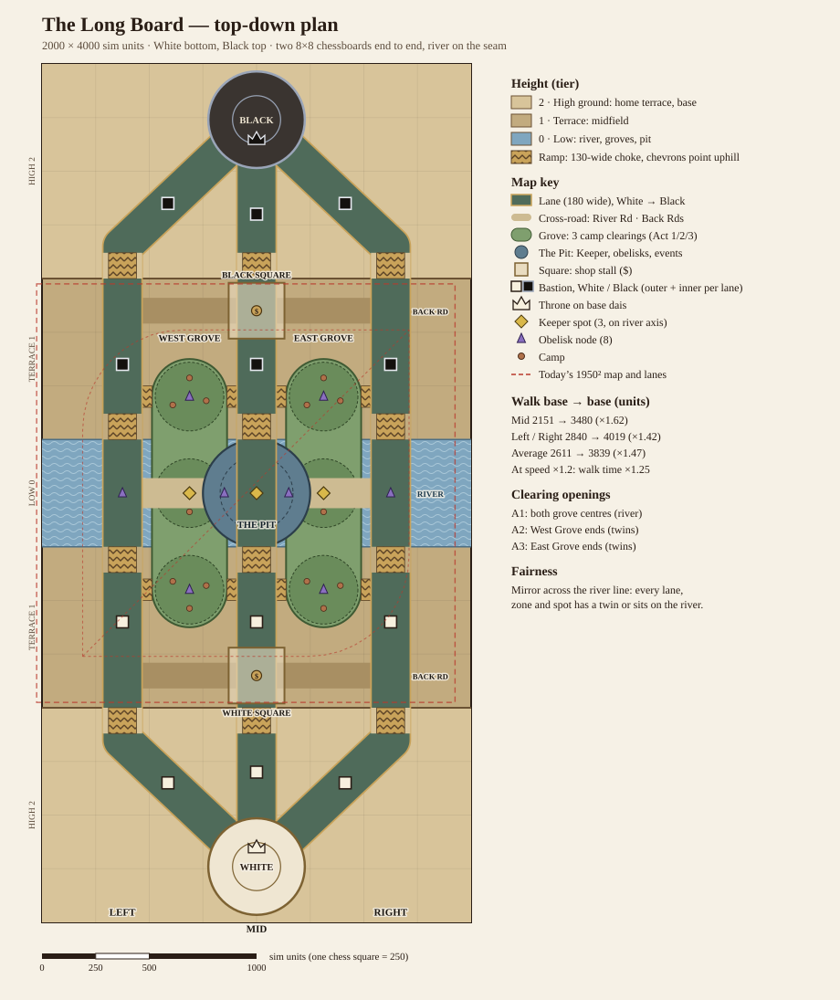

# Map spec: "The Long Board" (2026-10-11)

Design spec for the owner's workshop decision (2026-10-11). Status: **proposal, not built**. Branch `test-product-2`. Diagram: [img/map-longboard.svg](img/map-longboard.svg).

## 1. BLUF

1. **Two 8×8 chessboards end to end:** a 2000 × 4000 board. White's base is at the bottom, Black's at the top. Three straight lane-files (Left, Mid, Right) run base to base, with a river on the seam.
2. **Walks are about 1.5× longer:** the average lane goes from 2611 to 3839 units (×1.47). Raising unit speed by 20% (`speedMul` 1.5 → 1.8) makes walks take about 25% longer in time, and should keep the median match in 12–16 min (predicted 14.5–15.5).
3. **Three heights:** low river, a midfield terrace and a high home terrace, joined by 12 narrow lane ramps. There are two simple rules: **Reach** (ranged units shooting down get +15% range) and **Sight** (units on high ground spot enemies below 25% farther, and units below only see them up close).
4. **Five big zones instead of 13 scattered spots:** West and East Grove (all 6 camp clearings), the Pit (Keeper, obelisks, neutral events) and one shop Square per side. Three cross-roads (the River Road and two Back Roads) carry rotations. 59% of the board is open ground (40% today).
5. **Effort:** about 9–12 agent-days across 5 phases. Building it behind `?map=long` takes about 5–6 calendar days. Biggest risks: AI rotation/pathing, and the old Grand Board look (recommend retiring it).

## 2. Dimensions and coordinates

Sim units. x runs across (0 = White's left edge), and y runs along the board (0 = Black's end, 4000 = White's end). One chess square is 250. The board **mirrors across the river line y = 2000**: every lane maps onto itself with its ends swapped, and every zone or spot either has a twin or sits on the river. This is the same fairness rule as today's y = x mirror. Lane ids stay `top` / `mid` / `bot` (= White's Left / Mid / Right). Black's coordinates are White's with y → 4000 − y. Below, `e = |y − 2000|` is the distance from the river.

| Item                  | Value                                                                                                                                                              |
| --------------------- | ------------------------------------------------------------------------------------------------------------------------------------------------------------------ |
| Board                 | 2000 × 4000 (aspect 1 : 2), centre (1000, 2000)                                                                                                                    |
| Bases (spawn, shop)   | White (1000, 3740), Black (1000, 260); walk disc r 225, inner dais r 112                                                                                           |
| Thrones               | `guardianOffset` 89.7 toward the centre: White (1000, 3650), Black (1000, 350)                                                                                     |
| Lane `mid`            | (1000, 3740) → (1000, 260): length 3480                                                                                                                            |
| Lane `top` (Left)     | (1000, 3740) → (375, 3150) → (375, 850) → (1000, 260): length 4019. Leaves the base on a diagonal ("bishop"), then runs straight up file b ("rook")                |
| Lane `bot` (Right)    | (1000, 3740) → (1625, 3150) → (1625, 850) → (1000, 260): length 4019                                                                                               |
| Lane width            | 180 (half 90), unchanged; **65 half-width on ramps**                                                                                                               |
| River band            | y 1750–2250 (e ≤ 250), water drawn across the board; walkable only on lanes, the River Road and zones                                                              |
| Terraces              | Low 0: e < 370 (river, plus the climb of its ramps). Terrace 1: 370 ≤ e < 1120 (midfield). High 2: e ≥ 1120 (home terrace and base). Edges at e = 250 and e = 1000 |
| Lane ramps (12)       | Every lane at e 250–370 (river ramp) and e 1000–1120 (home ramp), both halves; 120 long, 130 wide. A ramp counts as its **lower** tier                             |
| Grove gates (8 ramps) | Width 100 (port r 50), from the lane down into a grove at y 1550 and 2450                                                                                          |
| Outer Bastions        | e = 600 on each file. White (375, 2600), (1000, 2600), (1625, 2600); Black y 1400                                                                                  |
| Inner Bastions        | Mid e = 1300: White (1000, 3300). Left/Right on the diagonal: White (587, 3350), (1413, 3350). Black (1000, 700), (587, 650), (1413, 650)                          |
| Bastion fractions     | Mid outer 0.328 / inner 0.126; sides outer 0.351 / inner 0.141 (today 0.3 / 0.14). Stored as explicit positions (see section 5)                                    |
| River Road            | Capsule (375, 2000)–(1625, 2000), r 70, low tier. Links Left, West Grove, Pit, East Grove and Right                                                                |
| Back Roads            | White (375, 2850)–(1625, 2850), Black y 1150, r 60, terrace tier. Behind your own outer Bastions, so rotations there are safe                                      |
| **West / East Grove** | Capsule (687.5 or 1312.5, 1550)–(…, 2450), r 175: 350 × 1250, 0.415 M units² each, low tier, sunken                                                                |
| Clearings (6 slots)   | r 160 at x 687.5 or 1312.5, y 1550 / 2000 / 2450. Opening Acts: both centres (on the river) in Act 1, West ends (twins) in Act 2, East ends (twins) in Act 3       |
| **The Pit**           | Disc (1000, 2000) r 250, low tier (drawn deeper). Mid lane and the River Road pass through it                                                                      |
| **Squares** (shops)   | Square half-side 130 (260 × 260) on Mid: White's (1000, 2850), Black's (1000, 1150). Stall at the centre, where the Back Road crosses Mid                          |
| Keeper spots (3)      | `k_pit` (1000, 2000) first, `k_wg` (687.5, 2000), `k_eg` (1312.5, 2000): all on the river                                                                          |
| Obelisk nodes (8)     | Pit (850, 2000), (1150, 2000); fords (375, 2000), (1625, 2000); one in each end clearing (slot-gated)                                                              |
| Spawns                | Pawnling and pawn waves at the base centre, out along each lane. Piece respawn in a row: x = 1000 + (slot − 2) × 30, y = base ∓ 10                                 |
| Neutral events        | `siteMode: neutral` picks the Pit or an open grove centre. Lane events start at lane t = 0.5 (Pit for Mid, fords for the sides)                                    |

### Today vs the Long Board

| Measure                                           | Today (1950 square)                    | Long Board                                               | Change                |
| ------------------------------------------------- | -------------------------------------- | -------------------------------------------------------- | --------------------- |
| Board                                             | 1950 × 1950 = 3.80 M                   | 2000 × 4000 = 8.00 M                                     | ×2.1                  |
| Walk base → base, Mid                             | 2151                                   | 3480                                                     | ×1.62                 |
| Walk base → base, Left / Right                    | 2840                                   | 4019                                                     | ×1.42                 |
| Average lane                                      | 2611                                   | 3839                                                     | **×1.47**             |
| Base → own outer Bastion (Mid / side)             | 645 / 852                              | 1140 / 1409                                              | ×1.77 / ×1.65         |
| Base → own inner Bastion (Mid / side)             | 301 / 398                              | 440 / 568                                                | ×1.46 / ×1.43         |
| Gap between the two outer Bastions (Mid / side)   | 861 / 1137                             | 1200 / 1200                                              | ×1.4 / ×1.06          |
| Jungle area (clearings + gates)                   | 0.93 M in 6 discs of 0.12–0.14 M       | 0.96 M in 2 groves of 0.42 M                             | +3%, 3× bigger pieces |
| Walkable area                                     | 2.27 M                                 | 3.31 M                                                   | +46%                  |
| **Open-ground share** (not walkable, not a zone)  | 40%                                    | **59%**                                                  | +19 pts               |
| Places to read                                    | 6 courts, 2 shops, 5 Keeper spots (13) | 5 zones, 3 roads                                         | Fewer                 |
| Phone fit, portrait 390×844 (free band 390 × 553) | 0.178 px/unit (table look `a`)         | ≈ 0.185 px/unit at about 48° tilt (width-bound)          | Pieces ≈ +4%          |
| Landscape 844×390 / desktop 1440×900 (White left) | board 61% / 72% of screen              | ≈ 0.19 / 0.33 px/unit, board ≈ 764 × 290 / 1338 × 500 px | Similar               |

## 3. High ground

How the sim stores height: a new pure module `src/sim/world/height.ts` with `tierAt(world, x, y): 0 | 1 | 2`. It returns 0 inside a grove, the Pit or a grove gate. Everywhere else it is 0 when e < 370, 1 when e < 1120, and 2 otherwise. The result is cached per 25-unit terrain cell in a `Uint8Array` that is built once in `buildWorld`. It uses integer comparisons only, so it is deterministic. The table view's `Relief.areaAt` / `atSim` read the same tiers (they stop computing their own) and add visual-only offsets: the Pit −18, a dais on the base, and the faces of the terraces.

| Rule      | Exact rule (numbers in `tuning.height`)                                                                                                                                                                                                                                         | Feel                                                                                        |
| --------- | ------------------------------------------------------------------------------------------------------------------------------------------------------------------------------------------------------------------------------------------------------------------------------- | ------------------------------------------------------------------------------------------- |
| **Reach** | When the attacker's tier is above the target's, its attack range is ×1.15 (`reachMul`). Applies only to attackers with base range ≥ 60 (`reachMinRange`): Queen 80 → 92, Bishop 110 → 126, ranged pawnlings 85 → 98. Melee, skills' own areas and **structures** are unchanged. | Ranged pieces hold the top of a ramp and poke down.                                         |
| **Sight** | Choosing a target (`behavior.ts`, the aggro scan): looking down, the radius is `aggroRadius` × 1.25 (150 → 187). Looking up, a unit only picks targets within its attack range + 20. Same tier: unchanged.                                                                      | High ground engages first. Units below get "jumped" at the ramp foot.                       |
| **Ramps** | Lanes narrow to 130 wide for 120 units at each terrace edge. No speed penalty, so walk-time maths stays simple.                                                                                                                                                                 | Natural chokepoints. A Barricade on a ramp is 154 wide instead of 204 and seals it cleanly. |

**Counterplay.** Bonuses vanish as soon as you stand on the same tier, so climb behind your pawnling wave: it soaks the first shots. Melee pieces (King, Rook, Knight) ignore Reach. The Knight's leap already clears solid terrain, so it can jump a terrace edge instead of taking the ramp. Area gambits (Sanctuary, Pawn Storm, Siege) ignore tiers. A Barricade on a ramp forces an attacker onto a Back Road or the River Road. Bastions get no bonus, so tower balance is unchanged.

**How the AI uses it** (small, local rules):

1. **Hold the top.** A piece with posture `defend`, or one whose lane front is behind its outer Bastion, stops at a hold point 60 units above the nearest ramp top in its lane rather than walking down to meet the wave.
2. **Climb with the wave.** An attacking piece waits at the ramp foot until its own pawnlings are on the ramp. This extends the existing siege gather (`siegeGather`, `siegeWaitTicks`).
3. **Fight odds.** `matchupAt` (`ai/power.ts`) gives the side holding the higher tier at the fight centre +10% power, so the AI picks fights uphill less often.
4. **Ranged kite.** Queen and Bishop, while lane-farming, step back up the ramp when a melee threat closes. This reuses the existing retreat path, with the target point set at the ramp top.

## 4. Timing and balance plan (keep the median at 12–16 min)

| Lever                         | Today                   | Proposed                                                                                      | Why                                                                                                       |
| ----------------------------- | ----------------------- | --------------------------------------------------------------------------------------------- | --------------------------------------------------------------------------------------------------------- |
| `movement.speedMul`           | 1.5                     | **1.8**                                                                                       | Walks take about 1.25× as long instead of 1.47×. The board feels long without dead time.                  |
| Pawnling speed (36 base)      | 54 u/s                  | 64.8 u/s                                                                                      | First wave clash: Mid 19.9 → 26.9 s, sides 26.3 → 31.0 s                                                  |
| Rook base → own outer Bastion | 9.6 s Mid / 12.6 s side | 14.1 s / 17.4 s                                                                               | Death costs more walking. Recall (3 s) still brings pieces home.                                          |
| Waves                         | first 6 s, every 30 s   | unchanged                                                                                     | Gold per Act stays the same. Waves are still 30 s apart; they just meet 7 s (Mid) or 5 s (sides) later.   |
| Bastions                      | 3600 hp, inner ×1.25    | hp unchanged; positions as in section 2                                                       | One lever at a time. Positions are terrain-led.                                                           |
| AI radii in `tuning.ai`       | for 1950                | `defendOffLaneRadius` 1170 → 1400, `shopTripRadius` 741 → 1100, `tier3TripRadius` 2535 → 3800 | The Back Roads and Squares are farther away. Fight-scale radii are unchanged (unit scale `k` stays 1.95). |

Predicted effect: longer walk-outs (+3–5 s per trip) and high-ground defence lengthen matches; a costlier death speeds up snowballs. Net estimate is a 14.5–15.5 min median. **If the median is above 15.5:** set `tower.hp` 3600 → 3300 first, then `speedMul` 1.9. **If it is below 12.5:** set `speedMul` 1.65. Watch **Open File** (+25% speed for 15 s is worth more on a long lane) and Barricade (ramps make it stronger).

**What to measure** (`npm run balance -- --matches 800 --seed 29000 --quiet --workers 2`, relics off and both-AI; then seed 31000):

- White win rate 48–52%; median match plus p10 / p90 minutes.
- When the first Bastion falls, per lane, and Act-1 net-worth lead (vs today).
- Fight share by tier, and the high-ground side's fight win rate. Target 55–62%: an edge, not a lock.
- Stuck units: no progress for 20 s while out of combat. Must be 0.
- Lane share (`tests/lane-share.test.ts`), camps cleared per Act, Keeper buys, obelisk claims per side, Barricades placed on ramps, Open File impact, style pick rates (≥ 15%).

## 5. Engineering plan

| Area                            | Files                                                                                                                                                                                                                    | Change                                                                                                                                                                                                                                                                                                                       | Risk           |
| ------------------------------- | ------------------------------------------------------------------------------------------------------------------------------------------------------------------------------------------------------------------------ | ---------------------------------------------------------------------------------------------------------------------------------------------------------------------------------------------------------------------------------------------------------------------------------------------------------------------------- | -------------- |
| Map data and schema             | `content/map.json` (new file `content/map-long.json` during the build), `src/sim/content/schema.ts`, `src/app/content.ts`, tools loader                                                                                  | `size` → `width`, `length`, `unitScale` (1.95). Add `terraces {river 250, rampLen 120, home 1000, rampHalf 65}`, `zones[]` (`grove` capsule, `pit` disc, `square` box, each with an id), `roads[]` (capsules), `bastions {A,B}{lane: [outer, inner]}` (replaces `towerFractions`). `slots` keep their ids, phases and ports. | Low            |
| Terrain and walkable            | `src/sim/world/terrain.ts`                                                                                                                                                                                               | Rectangular cell grid (cols × rows). New shape kinds `road`, `grove`, `pit`, `square` (box distance), `ramp` (lane pieces at r 65). Grove floors are walkable all match, not slot-gated. `confine` / `clearLine` are unchanged.                                                                                              | Medium         |
| Height                          | new `src/sim/world/height.ts`                                                                                                                                                                                            | `tierAt` and its cache (section 3)                                                                                                                                                                                                                                                                                           | Low            |
| World and pathing               | `src/sim/world/map.ts`, `src/sim/match.ts` (`Grid(width, length)`)                                                                                                                                                       | `k` from `unitScale`. Towers from explicit positions. Guardian points toward (W/2, L/2). Nav nodes along roads, grove spines and squares. Slot nodes stay gated by open state.                                                                                                                                               | Medium         |
| Bounds                          | `src/sim/combat.ts` (dash clamp), `src/sim/gambits.ts` (point-off-map check, `wallFor` also takes `ramp` / `road`)                                                                                                       | Clamp to width / length                                                                                                                                                                                                                                                                                                      | Low            |
| Camps, Keeper, obelisks, events | `camps.ts` (mirror = flip dy, not swap dx/dy), `keeper.ts`, `obelisks.ts`, `events.ts` (`onAxis` → \|y − L/2\| < 1.5, the Pit as a neutral site), `pressure.ts`                                                          | Mostly data. Mirror and axis logic change.                                                                                                                                                                                                                                                                                   | Low–Med        |
| Spawns                          | `src/sim/systems.ts` (respawn row), `src/sim/units.ts`                                                                                                                                                                   | Respawn offsets assume a diagonal base today                                                                                                                                                                                                                                                                                 | Low            |
| Rules                           | `combat.ts` (`inAttackRange`: Reach), `behavior.ts` (target scan: Sight), `tuning.json` `height` block                                                                                                                   | Section 3                                                                                                                                                                                                                                                                                                                    | Medium         |
| AI lanes and rotation           | `src/sim/ai/strategic.ts`, `ai/lanes.ts`, `ai/power.ts`                                                                                                                                                                  | Ramp hold points, climb gate, uphill odds, rotations via roads, retuned radii                                                                                                                                                                                                                                                | **High**       |
| Fight zone tags                 | `src/sim/feedback.ts`, `src/analysis/feedback.ts`                                                                                                                                                                        | Zones become lane / grove / Pit / base                                                                                                                                                                                                                                                                                       | Low            |
| Table render                    | `src/render/table/relief.ts` (tiers from the sim), `board.ts` (8 × 16 painted top, river, roads, groves, squares, Pit), `camera.ts` (straight framing only, drop diamond), `lanecam.ts`, `view.ts` (half width / length) | Rebuild of the geometry. Palette and look are unchanged. Relief grid 100 × 200 cells (same triangle budget).                                                                                                                                                                                                                 | Medium         |
| Report and intro                | `src/render/replay.ts` (draw the real board), `src/ui/intro.ts`, `src/ui/hud/Intro.tsx`                                                                                                                                  | Rectangle, White at the bottom                                                                                                                                                                                                                                                                                               | Low            |
| Grand Board look                | `src/render/broadcast/**` (about 10.6k lines, assumes a 1950 square)                                                                                                                                                     | Retire it, or port it (+4 days)                                                                                                                                                                                                                                                                                              | High if ported |
| Tests                           | `tests/symmetry.test.ts` (y mirror), `terrain`, `shops`, `lane-share`, `tablecam`, `golden`, `determinism`, `tests/baseline.expected.json`                                                                               | Rewritten on purpose. Baseline re-recorded once, after balance.                                                                                                                                                                                                                                                              | Medium         |

**Phased build** (the old map stays the default until Phase 5; `?map=long` in the app, `--map long` in balance and baseline):

| Phase | Who                                                            | Builds                                                                                                                                                                    | Verified by                                                                                                       | Effort                   |
| ----- | -------------------------------------------------------------- | ------------------------------------------------------------------------------------------------------------------------------------------------------------------------- | ----------------------------------------------------------------------------------------------------------------- | ------------------------ |
| 1     | Agent A (sim)                                                  | Schema, `map-long.json`, terrain, world and nav, bounds, camps/Keeper/obelisks/events, spawns, map flag                                                                   | New symmetry test, terrain tests, a 100-match smoke run with 0 stuck units, every match ends                      | 2–3 days                 |
| 2     | Agent B (rules + AI), after A                                  | `height.ts`, Reach, Sight, ramp hold, climb gate, uphill odds, AI radii                                                                                                   | A unit test per rule (deterministic fixtures), a 200-match smoke run with fight-by-tier stats                     | 1.5–2 days               |
| 3     | Agent C (render), after A's schema is frozen; runs alongside B | Relief, board painting, camera framing (portrait, landscape, desktop), lane camera, replay map, intro                                                                     | `tests/tablecam.test.ts`, screenshots at 390×844, 844×390 and 1440×900, board px numbers, draw calls ≤ today +10% | 3–4 days                 |
| 4     | Agent D (balance), after B                                     | `speedMul` 1.8 and levers; 800 × seed 29000 (relics off and both-AI), then 31000                                                                                          | Section 4 targets; baseline re-recorded on purpose                                                                | 1–2 days (machine-bound) |
| 5     | Agent A or D                                                   | Flip the default, delete the old map, `npx playwright test`, docs (CHESS.md map section, SOURCE_OF_TRUTH, CHANGELOG, reversed decision: square diagonal map → Long Board) | `npm run check`, e2e, owner play-test                                                                             | 1 day                    |

Total: about **9–12 agent-days**, about **5–6 calendar days** with 2–3 agents. Run one balance job at a time with `--workers 2` (the machine is shared).

## 6. Open decisions for the owner

| #   | Decision               | Options                                                                                              | Recommendation                                                                                               |
| --- | ---------------------- | ---------------------------------------------------------------------------------------------------- | ------------------------------------------------------------------------------------------------------------ |
| 1   | Unit speed             | 1.5 (walks take 1.47× as long, about +2 min per match) / **1.8** (1.25×) / 2.2 (walk time unchanged) | **1.8**: the board feels longer, and matches should stay in 12–16 min                                        |
| 2   | Old "Grand Board" look | Retire it when the Long Board ships / port it (+4 days)                                              | **Retire it.** The Tournament Table is the chosen look, and porting costs about 4 days.                      |
| 3   | Height rules           | Reach + Sight / Reach only / visual only                                                             | **Reach + Sight**, structures excluded. Tune them down if the high-ground side wins more than 62% of fights. |
| 4   | Grove access           | Grove floors open all match, camps appear by Act / today's iron gates that open per Act              | **Open floors.** Simpler paths and more open ground; the Act openings still pace the camps.                  |
| 5   | Shops                  | One Square per side on Mid / a stall at each grove end                                               | **One Square per side**: one purpose per zone                                                                |
| 6   | Rollout                | Behind `?map=long` until balance passes / switch at once                                             | **Behind the flag**: the old map stays playable and comparable until the 800-match runs pass                 |
